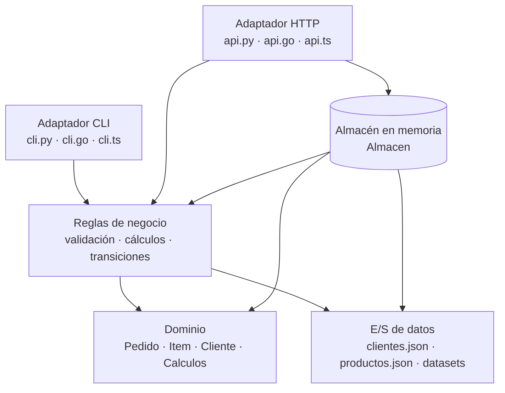
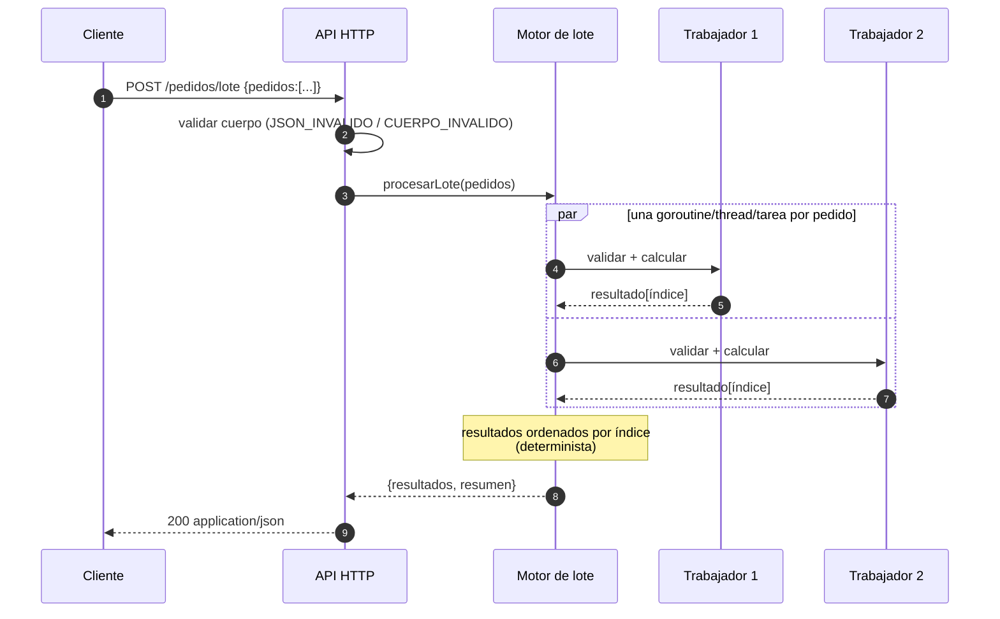
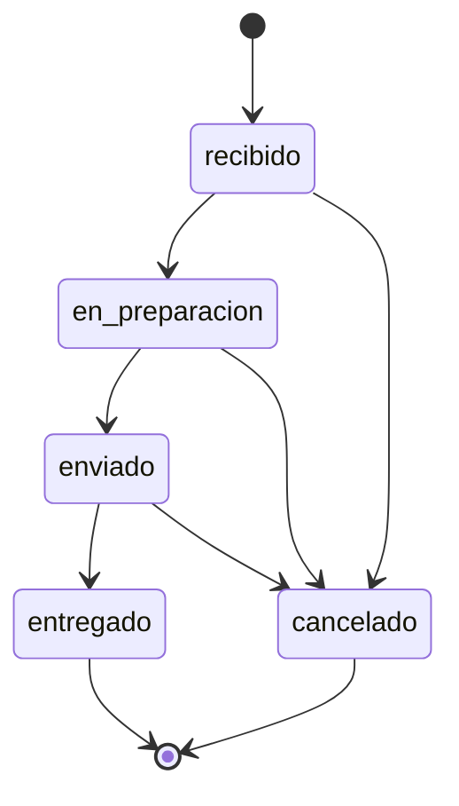

# Diagramas del proyecto

Diagramas en sintaxis Mermaid (se renderizan en GitHub, VS Code o cualquier visor Mermaid).
Todos describen el comportamiento **común** a las tres implementaciones; lo que cambia entre
lenguajes es la sintaxis, no la estructura.

## 1. Capas de una implementación



## 2. Procesamiento de `POST /pedidos/lote`



## 3. Vista comparativa del frontend

```mermaid
flowchart LR
    U[Usuario] -->|elige dataset| F[frontend/app.js]
    F -->|POST /pedidos/lote| PY["API Python :8001"]
    F -->|POST /pedidos/lote| GO["API Go :8002"]
    F -->|POST /pedidos/lote| JS["API JS :8003"]
    PY -->|performance.now()| T[Tiempos por lenguaje]
    GO --> T
    JS --> T
    T --> TAB["Tabla: tiempo · pedidos · monto · LOC · paradigma"]
    T --> G["Gráfico de barras (canvas)"]
    LOC[("loc_resultados.json")] --> TAB
    TAB --> U
    G --> U
```

## 4. Estados de un pedido



Cualquier otra transición (incluido repetir el mismo estado) se rechaza con `TRANSICION_INVALIDA`.
